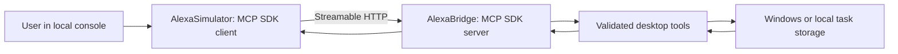

# keyboard.wtf × Alexa — Local MCP companion

An independent Windows-oriented companion exposing a small, safe subset of desktop actions through the Model Context Protocol (MCP). This project is inspired by the original [keyboard.wtf](https://github.com/UnknownGod2011/keyboard.wtf), but runs separately and does not require the original application to be installed.

**Status:** early functional prototype. A real MCP client/server round-trip has passed automated Windows CI, but the interactive Windows desktop, GUI, authentication, and production Alexa+ integration have **not** been verified or completed. This is not an official Amazon Alexa application.

## Features available now

- **Real Streamable HTTP MCP:** official C# SDK 2.3.0, server at `http://127.0.0.1:32178/mcp`.
- **No-key console simulator:** a separate .NET MCP client that discovers tools and calls them over HTTP; no AI account required.
- **Desktop status:** reports non-sensitive process/platform information.
- **Open Notepad:** asks for explicit confirmation in the console before requesting a Windows process launch. A returned PID does not prove a visible window. Other MCP clients can currently call this tool without that console confirmation.
- **Task handoffs:** save and load bounded, named task summaries from local application data.
- **Automated protocol smoke:** starts server and client in separate processes, checks initialization, discovery, real tool calls, input rejection, unknown tools, and HTTP Host/Origin defenses.

## Prerequisites

- Windows 10/11 recommended; `open_notepad` is Windows-only.
- .NET 8 SDK.
- Internet access for the initial NuGet package restore.
- Python 3.12+ **only if** you want to run the optional automated smoke test locally.

## Run from a fresh clone

The implementation currently lives on the development branch; `main` is not yet release-ready.

```powershell
git clone https://github.com/UnknownGod2011/Alexa-keyboard.wtf.git
cd Alexa-keyboard.wtf
git switch codex/alexa-plus-completion
dotnet restore src/AlexaBridge/AlexaBridge.csproj
dotnet restore src/AlexaSimulator/AlexaSimulator.csproj
```

**Terminal 1 — start the local MCP server:**

```powershell
dotnet run --project src/AlexaBridge/AlexaBridge.csproj
```

**Terminal 2 — start the independent no-key simulator:**

```powershell
dotnet run --project src/AlexaSimulator/AlexaSimulator.csproj
```

Type `tools` to discover the actual MCP tools, `status` for a safe read-only action, `save` to record a non-sensitive task summary, and `load` to retrieve it. Type `notepad` to request a Windows Notepad launch after a local console confirmation. Type `quit` to close the simulator; stop the server in Terminal 1 with Ctrl+C.

The simulator is a **console application**, not yet a graphical or voice assistant. It uses the real MCP client transport and does not call desktop methods directly.

## Available MCP tools

| Tool | Behavior |
| --- | --- |
| `get_desktop_status` | Returns OS/process information without modifying the desktop. |
| `open_notepad` | Requests a Windows Notepad process launch; window visibility must be checked manually. |
| `save_task_handoff` | Saves a bounded named task summary to local application data. |
| `load_task_handoff` | Loads a previously saved task summary by name. |

Other compatible MCP clients can connect to `http://127.0.0.1:32178/mcp` using Streamable HTTP. Use MCP initialization and tool discovery, not the `/health` route, to verify protocol compatibility.

## Tests

Build both projects in Release mode:

```powershell
dotnet build src/AlexaBridge/AlexaBridge.csproj -c Release
dotnet build src/AlexaSimulator/AlexaSimulator.csproj -c Release
python scripts/run-protocol-smoke.py
```

The smoke script starts the real server, waits for readiness, invokes the independent official-SDK client, and stops the server. It does not launch Notepad, require API credentials, or prove a visible Windows UI.

The Windows GitHub Actions workflow passed this protocol smoke on commit `c9c8a4a`: [workflow run 39977136792](https://github.com/UnknownGod2011/Alexa-keyboard.wtf/actions/runs/39977136792). See [test evidence](docs/TEST_RESULTS.md).

## Architecture



The server binds only to `127.0.0.1:32178`, checks Host and Origin headers, and exposes no general shell execution tool. The simulator and server are separate processes.

## Privacy and security

The current server **does not authenticate local MCP clients**. Loopback binding and Origin/Host checks are useful but are not complete protection against malicious local software. Do not tunnel, proxy, or expose this endpoint to the public Internet. Only run it on a computer you trust.

Saved task summaries are stored as **plaintext** under the current user's local application data directory; never store credentials or sensitive content. Other MCP clients can call the available tools without the simulator's interactive confirmation. Stronger authorization is required before adding more powerful desktop actions.

## Optional AI and Alexa+ integration

No external API key is required for the implemented features. Conversational AI, a graphical/voice simulator, and production Alexa+ connectivity are **not yet implemented**. The local MCP server is not automatically accessible from Amazon's cloud. Remote connectivity would require a separately designed, authenticated integration.

## Troubleshooting

- **Connection refused:** start the bridge in Terminal 1 before launching the simulator.
- **Port 32178 in use:** close the other instance of the bridge; only one can bind the fixed port.
- **Notepad unavailable:** `open_notepad` requires Windows and a usable interactive desktop.
- **Build failure:** verify .NET 8 SDK and network access for package restore.
- **No source after cloning:** switch to `codex/alexa-plus-completion` until the verified release is merged into `main`.

See [implementation plan](docs/IMPLEMENTATION_PLAN.md) and [progress](docs/PROGRESS.md) for current limitations and next steps.
