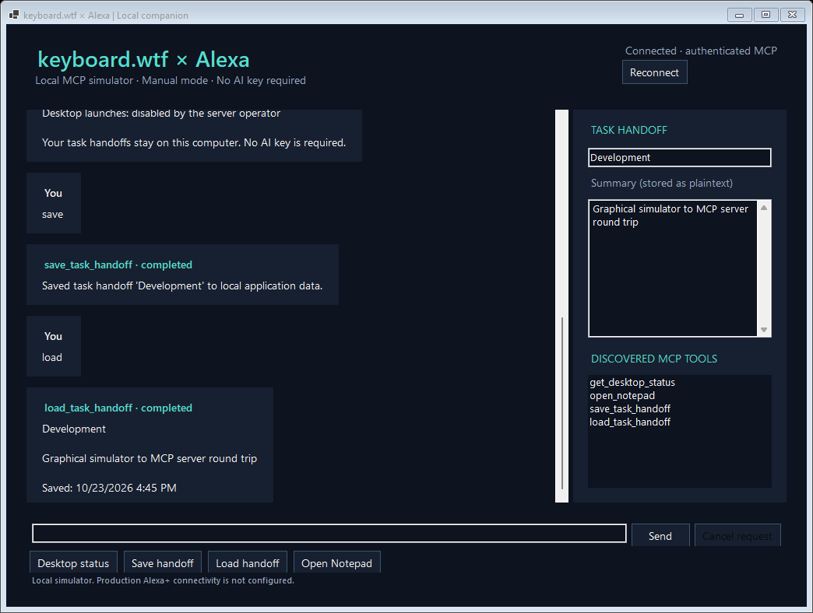

# keyboard.wtf × Alexa — Local MCP companion

A standalone Windows companion that exposes a small set of desktop capabilities through the Model Context Protocol. A console simulator and a Windows graphical simulator use the same authenticated MCP client over Streamable HTTP.

**Status:** development preview. Automated Windows protocol and regression checks, the combined launch policy, and the graphical simulator build pass CI; visible Windows interaction and production Alexa+ connectivity remain unverified. This is an independent application, not an official Amazon Alexa product.

## Implemented features

- Official C# MCP SDK 2.3.0, with a loopback Streamable HTTP endpoint.
- Automatic local authentication: a new random 256-bit token for each server start, discovered by same-user clients.
- No-key manual mode: discover tools, retrieve desktop status, and save/load task handoffs.
- Windows graphical simulator: conversation/action history, connection state, discovered tools, handoff fields, reconnect, request cancellation, and real execution results.
- Windows Notepad launch: disabled by default, requires operator opt-in and a fresh approval in the server console for each request.
- Validation and storage failures return MCP tool errors; no simulated success responses.



*Actual Windows control render from CI after genuine MCP status/save/load calls. This is not proof of end-user desktop or Alexa cloud connectivity.*

The original [keyboard.wtf](https://github.com/UnknownGod2011/keyboard.wtf) application is separate and is not required.

## Prerequisites

- Windows 10/11 for the graphical simulator and Notepad.
- .NET 8 SDK (including Windows desktop support).
- Network access for the first NuGet restore.
- Python 3.12+ only for the protocol smoke script.

The bridge, shared client and console can also build for .NET 8 on non-Windows systems; Windows actions are unavailable there.

## Build and run

The implementation currently lives on the development branch; `main` is not a runnable release yet.

```powershell
git clone https://github.com/UnknownGod2011/Alexa-keyboard.wtf.git
cd Alexa-keyboard.wtf
git switch codex/alexa-plus-completion
dotnet build src/AlexaBridge/AlexaBridge.csproj -c Release
dotnet build src/AlexaSimulator/AlexaSimulator.csproj -c Release
dotnet build src/AlexaDesktop/AlexaDesktop.csproj -c Release
```

**Terminal 1 — bridge:**

```powershell
dotnet run --project src/AlexaBridge/AlexaBridge.csproj -c Release --no-build
```

**Terminal 2 — graphical simulator:**

```powershell
dotnet run --project src/AlexaDesktop/AlexaDesktop.csproj -c Release --no-build
```

Or use the console instead:

```powershell
dotnet run --project src/AlexaSimulator/AlexaSimulator.csproj -c Release --no-build
```

Run both processes as the same OS user. Start the bridge first. No cloud API key, account, or private configuration from the original application is needed.

### Single-launcher option

From Windows PowerShell in the source folder:

```powershell
.\scripts\start-local.ps1
```

It builds the projects, starts a bridge console, opens the graphical simulator, and requests authenticated bridge shutdown when the simulator closes. Add `-EnableDesktopActions` to opt in to per-request launch approvals, or `-Console` to use the console client. `-SkipBuild` uses an existing Release build. The launcher refuses an occupied port and never intentionally stops a server it did not start.

### Preview package

```powershell
.\scripts\package-windows.ps1
```

This prepares a framework-dependent development package in `artifacts/windows-preview`; it refuses to overwrite an existing output directory. Windows CI also uploads that folder as `windows-development-preview`. See [package instructions](docs/PREVIEW_PACKAGE.md). This is a preview artifact, not a verified release or a claim that interactive Windows tests passed.

## No-key walkthrough

1. Connect. The simulator initializes MCP and discovers the actual server tools.
2. Choose **Desktop status** or type `status`.
3. Enter a task name and a non-sensitive summary in the handoff fields. Choose **Save handoff**.
4. Choose **Load handoff** to retrieve the persisted record through MCP.
5. Request **Open Notepad**. By default the bridge returns a denial.
6. To test an actual launch, stop the bridge and restart it in Terminal 1 with:

```powershell
$env:ALEXA_ALLOW_DESKTOP_ACTIONS = "1"
dotnet run --project src/AlexaBridge/AlexaBridge.csproj -c Release --no-build
```

Reconnect the simulator after the bridge restarts. Request Notepad again. In Terminal 1, type the exact `approve <code>` shown by the bridge within 30 seconds, or `deny <code>`. Each code applies only to the pending request. MCP clients cannot grant approval through tool arguments.

Verify the Notepad window yourself: a returned PID reports process launch, not verified window visibility. Headless/redirected hosts deny launches even when the environment opt-in is set. To explicitly deny launches, pass `-- --deny-actions` to the bridge.

Close the simulator when finished, then use Ctrl+C in Terminal 1 to stop the bridge. A cancelled request does not undo an action already accepted by Windows.

### Manual commands

| Command | Action |
| --- | --- |
| `tools` | Discover real MCP tools |
| `status` | Get desktop companion status |
| `save` | Save the named summary (console asks for fields) |
| `load` | Load a saved summary |
| `notepad` / `open notepad` | Request a server-approved Windows launch |

The graphical simulator accepts this explicit vocabulary. Other text shows help and does not execute a desktop action. It does not pretend to be a cloud conversational model.

## MCP clients

Endpoint: `http://127.0.0.1:32178/mcp`, Streamable HTTP.

| Tool | Behavior |
| --- | --- |
| `get_desktop_status` | Safe OS/process information and launch policy |
| `save_task_handoff` | Write a named summary in dedicated local storage |
| `load_task_handoff` | Read a validated saved summary |
| `open_notepad` | Default-denied launch; operator opt-in plus per-request approval |

On Windows the bridge creates its token at `%LOCALAPPDATA%\AlexaKeyboardBridge\runtime\mcp-auth-token`. Other same-user clients must read it and send `Authorization: Bearer <token>` on every MCP request, including GET and DELETE. Never commit, log, or share the token. The included clients handle it automatically.

An authenticated `POST /local/shutdown?processId=<owned-pid>` endpoint supports graceful lifecycle control; it is separate from the MCP tool inventory. The unauthenticated `/health` endpoint is for startup checks; it does not prove MCP interoperability.

## Tests

```powershell
dotnet build src/AlexaBridge/AlexaBridge.csproj -c Release
dotnet build src/AlexaSimulator/AlexaSimulator.csproj -c Release
dotnet build src/AlexaDesktop/AlexaDesktop.csproj -c Release
python scripts/run-protocol-smoke.py
dotnet run --project tests/AlexaBridge.Checks/AlexaBridge.Checks.csproj -c Release
```

The smoke script starts the real bridge, initializes the independent SDK client, discovers tools, and tests authenticated calls, handoff persistence, invalid inputs, missing records, denied launches, unknown tools, and Host/Origin/authentication defenses. It uses temporary handoff storage and does not launch Notepad.

The regression executable tests permission denials, cancellation before side effects, launch failure reporting, storage validation, corrupt files, concurrent atomic saves, and manual command routing. Its recording launcher is a test adapter, not evidence of a real desktop launch.

An independent Python HTTP client additionally checks MCP `2025-11-25` negotiation, initialization lifecycle, argument schemas, concurrent calls, and protocol errors. Startup tests reject a second server without rotating its live token; shutdown tests require authentication and verify credential cleanup. Runtime and handoff directories are isolated during smoke tests. Windows CI also exercises published DLLs and the extracted launcher from a directory with spaces. It verifies that the launcher refuses a foreign listener and that shutdown rejects an owner-process mismatch.

Windows CI builds the graphical simulator but does not establish its visual layout or visible desktop behavior. See [test evidence](docs/TEST_RESULTS.md) and [interactive Windows checks](docs/WINDOWS_MANUAL_TEST.md).

## Security and privacy

- Fixed loopback binding, Host/Origin validation, and per-start local bearer authentication. Inherited ASP.NET URL/Kestrel endpoint settings cannot select other listeners.
- A file lease prevents a second bridge instance from replacing a running server's token.
- Notepad resolves to the Windows system directory, never arbitrary commands, PATH entries, or caller-supplied executables.
- Saved summaries are plaintext under local application data. Names and contents are validated, writes are atomic, and corrupt/oversized/version-mismatched records fail.
- An authenticated client can write bounded summaries without per-write confirmation; it cannot select an arbitrary filesystem path.
- Same-user malware can read the credential and local data. This does not provide isolation from malicious programs running as your OS account.
- Do not tunnel or expose the bridge to the Internet. Remote Alexa+ access requires a separate authenticated architecture.

## AI and Alexa+ connectivity

No external API keys are required for the implemented tools. Optional conversational AI and voice are not implemented yet. Production Alexa+ registration, authentication, networking, and end-to-end connectivity are also not implemented or verified. The local simulator demonstrates the MCP execution path without claiming Amazon cloud access.

## Troubleshooting

- **Disconnected / HTTP 401:** start the bridge under the same OS user; reconnect after every bridge restart because its credential rotates.
- **Port or instance lock in use:** close the existing bridge before starting another.
- **Notepad denied:** enable the operator policy before server start, keep its console interactive, then approve the individual request there.
- **Invalid handoff name:** use 1–64 ASCII letters/digits/internal spaces/dash/underscore; no leading/trailing spaces or Windows device names.
- **Save/load error:** check local data permissions and record format. Never place credentials in summaries.
- **Build failure:** verify .NET 8 SDK and NuGet connectivity.
- **No source after clone:** switch to the development branch until validated functionality is integrated into `main`.

See [architecture](docs/ARCHITECTURE.md), [progress](docs/PROGRESS.md), and [release readiness](docs/RELEASE_READINESS.md).
