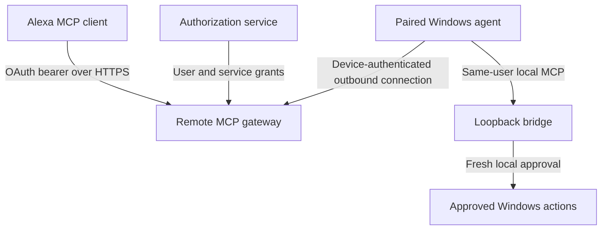

# Remote Alexa+ integration boundary

Status: researched design only. No relay, OAuth service, account linking, add-on registration or production Alexa connection has been implemented or deployed. The runnable implementation remains a local MCP companion and simulator.

## Verified external requirements

Reviewed 2026-10-24 (Asia/Calcutta):

- Amazon's [MCP QuickStart](https://developer.amazon.com/docs/alexaplus/add-ons/mcp-toolkit-quickstart) requires Streamable HTTP and a remote server URL. Its current checklist specifies protected-resource/authorization-server metadata, PKCE S256, resource-bound bearer requests and a round-trip query latency below 500 ms. It currently excludes WWW-Authenticate in 401 responses. Registration uses authenticated Alexa developer tooling.
- [MCP authentication](https://developer.amazon.com/docs/alexaplus/add-ons/mcp-toolkit-authentication) distinguishes service credentials for initialization/discovery from user authorization for personalized tool execution.
- [Account linking](https://developer.amazon.com/docs/alexaplus/add-ons/mcp-toolkit-account-linking) applies when tools use private user data or perform writes for a customer. It documents static client registration, authorization-code/PKCE flow, refresh tokens and registered Alexa redirect URIs.

These requirements do not establish that this repository is registered, eligible, certified or connected. Recheck the official requirements when implementing an actual deployment.

## Proposed architecture

This is a proposed separation of trust boundaries, not a description of deployed components. The gateway would expose a deliberately smaller remote surface than the local bridge. The Windows agent would initiate its connection; no inbound desktop port or direct tunnel to port 32178 is needed.

## Required controls before implementation can be called connected

1. Bind an explicitly paired device to an authenticated service user. Short-lived pairing challenges must be confirmed on that PC, expire and be revocable. Keep device credentials separate from the per-launch local MCP bearer and from the customer's OAuth tokens.
2. Separate service-only discovery from user-specific execution. Proposed user scopes might include workspace read/restore; service credentials must never retrieve root paths, summaries or execute tools. Validate token issuer, audience/resource, expiry and scopes on every request.
3. Route only versioned, schema-validated requests for known saved-workspace names to the paired device. Never carry arbitrary shell strings, executable paths, root configuration or approval decisions from the cloud. Recheck device ownership, root binding and host policy immediately before execution.
4. Keep the current local operator opt-in and fresh approval for the exact saved action bundle. A remote model, gateway credential or pairing grant must not satisfy that local approval. Report denied, expired, offline, cancelled, partial and unverified outcomes accurately.
5. Bind request IDs to user/device/action, reject replay and retain a bounded outcome record so reconnects cannot duplicate a launch. An offline PC must not silently execute an old queued command later. Retrying a side effect requires an explicit policy and visible status.
6. Design fast request acceptance and explicit job-status retrieval if approval exceeds the remote latency budget. Measure the real Alexa client behavior before selecting that contract; the current synchronous local tool is not proven to meet remote latency requirements.
7. Keep the local authentication behavior intact. Any Alexa-specific metadata/error behavior belongs in a separately tested gateway profile. The local bearer endpoint is not an OAuth server and is not an Alexa account-linking implementation.
8. Minimize telemetry and user data in transit/logs. Never upload the local MCP token, keys, arbitrary file contents or implicit desktop context. Document data retention and provide disconnect/revocation controls.

## External blockers and next evidence

Actual deployment requires a chosen authorized hosting/OAuth service, user-approved external account configuration, Alexa developer authentication/registration, privacy/terms URLs and device pairing. None is available as a verified project integration here. Do not provision paid infrastructure, change external account permissions or expose the desktop endpoint on the strength of this design.

Before claiming connectivity, test wrong-user/device routing, service-token execution denial, expired/revoked tokens, replay/reconnect, PC offline, local-deny/cancel and partial-action results; then complete real account linking and Alexa simulator/device calls. A local SDK smoke, health response or architecture diagram is insufficient evidence.
